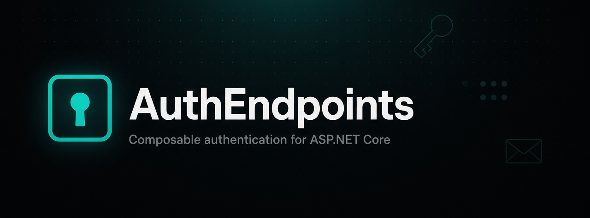

<p align="center">
  
</p>

[](https://www.nuget.org/packages/AuthEndpoints/)
[](https://www.nuget.org/packages/AuthEndpoints.External.OAuth/)
[](https://github.com/madeyoga/AuthEndpoints/issues)
[](https://www.nuget.org/packages/AuthEndpoints/)

[](https://github.com/madeyoga/AuthEndpoints/blob/main/LICENSE)

AuthEndpoints is an ASP.NET Core library of ready-made auth API endpoints on top of Identity. It fits a first-party auth API for web and mobile clients (React, Next.js, Vue, Nuxt, Svelte, native apps, and similar) with email/password, cookies, JWT, and/or passkeys.

- Ready-made endpoints for registration, login, password reset, 2FA, and session/token flows
- Opinionated password facade with `AddPasswordAuth` / `UseAuthEndpoints` / `MapPasswordAuth` (cookie by default, JWT via `AuthEndpointsSession.Jwt`)
- Account lifecycle: register, confirm email, forgot/reset password, manage info and 2FA, step-up ReAuth
- Sign-in stacks you choose: cookie sessions, Identity bearer tokens, or Simple JWT
- Passkeys (WebAuthn) for passwordless register and login
- Optional emailed one-time codes (`POST /identity/emailCode/send` and `POST /identity/emailCode/verify`). Sign-up and magic links stay off until you enable them
- Built-in hardening: rate limiting, antiforgery, lockout-aware login, hashed JWT refresh tokens with reuse detection
- GitHub and Google OAuth in `AuthEndpoints.OAuth.GitHub` and `AuthEndpoints.OAuth.Google`. The endpoints live in the core package. Compose them. The facades do not map them. See [External OAuth](https://authendpoints.harten.id/modules/external-oauth)

## Getting started

Requires .NET 10, ASP.NET Core Identity, and EF Core.

```bash
dotnet add package AuthEndpoints
```

```cs
builder.Services.AddDbContext<AppDbContext>(/* your provider */);

builder.Services.AddPasswordAuth<AppUser, AppDbContext>(o =>
{
    o.Passkeys.ServerDomain = "example.com"; // omit to leave passkeys off
});

builder.Services.AddTransient<IEmailSender<AppUser>, MyEmailSender>();

var app = builder.Build();

app.UseAuthEndpoints();
app.MapPasswordAuth<AppUser>();

app.Run();
```

## Documentation

For configuration, composable modules, route tables, and production guidance, see the [AuthEndpoints documentation](https://authendpoints.harten.id/).

## AI agents

Add the coding-agent skill from this repository:

```bash
npx skills add madeyoga/AuthEndpoints
```

See [AI agents](https://authendpoints.harten.id/guides/ai-agents/).

## Contribute

Issues and pull requests are welcome. Open an issue at [madeyoga/AuthEndpoints](https://github.com/madeyoga/AuthEndpoints/issues) to report bugs or propose changes.

## License

This project is licensed under the [MIT License](LICENSE).
